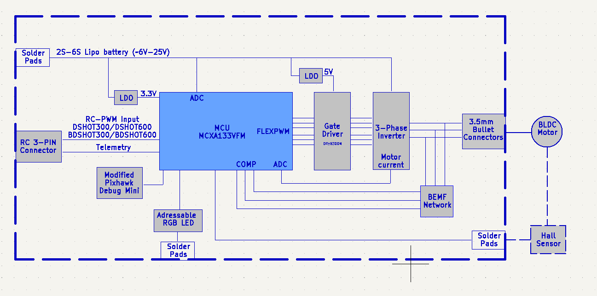

# MR-ESC-AM32 overview

The MR-ESC-AM32 is the electronic speed controller (ESC) reference design of the NXP Mobile
Robotics family. It is a brushless DC (BLDC) motor controller based on the open-source AM32 firmware
and implemented with an NXP MCX A microcontroller. It is designed for drones, robotic vehicles, and
other applications requiring sensorless BLDC motor control under the direction of an external flight
controller or motor-control system. The board is intended as a validated ESC starting point that
customers can evaluate, reproduce, and customize for their own vehicles.

The controller is built around an NXP MCXA133 microcontroller, an Arm Cortex-M33 MCU running the NXP
port of the AM32 firmware. It implements six-step commutation using back-EMF (BEMF) zero-cross
detection and accepts RC-PWM, DShot, and bidirectional DShot control interfaces.

## Functional block diagram

<figure>
  
</figure>

Figure 1. MR-ESC-AM32 functional block diagram

## Main components

The reference design integrates the following main components and interfaces:

- NXP MCXA133 microcontroller (Arm Cortex-M33) running the AM32 firmware
- DRV8300N three-phase gate driver and a MOSFET-based power stage
- Sensorless BEMF-detection network for six-step commutation
- RC-PWM, DShot, and bidirectional DShot control interfaces
- KISS-format serial telemetry (TX) output
- Addressable RGB status LED and a modified Pixhawk debug connector
- Optional Hall-sensor / quadrature-encoder solder pads (hardware provision only)

NXP also provides the complete hardware Bill of Materials and design files, enabling customers to
evaluate, reproduce, and customize the reference platform for their own products.

For overview information, documentation, software, tools, and ordering details, see the
[MR-ESC-AM32 product page](https://www.nxp.com/design/design-center/development-boards-and-designs/MR-ESC-AM32)
on the NXP web site.
