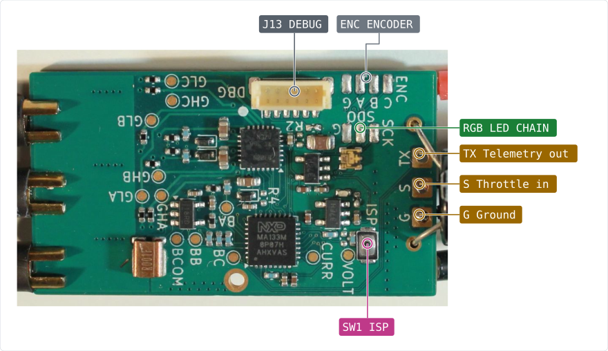
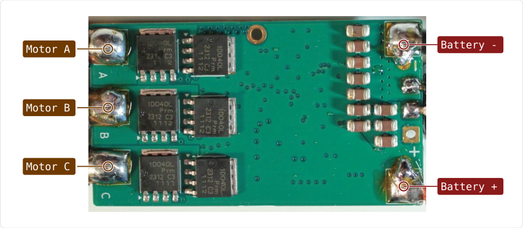
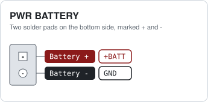
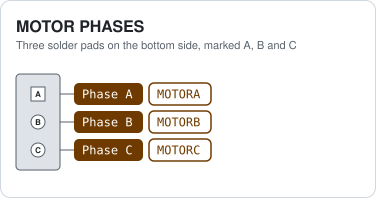
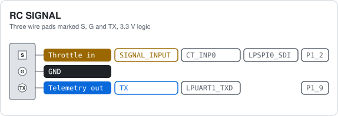
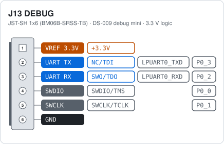
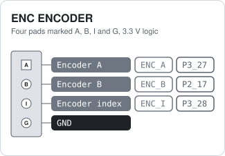
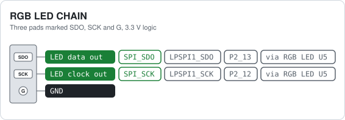

# MR-ESC-MCXA-AM32 hardware reference

Connectors, solder pads and pinouts of the NXP MR-ESC-MCXA-AM32, a proof-of-concept drone motor
ESC (Electronic Speed Controller) built on the NXP MCXA153/MCXA133 MCU and running the open-source
AM32 firmware. All pin data below comes from the public KiCad design files in the
[MR-ESC-MCXA-AM32 repository](https://github.com/NXP-Robotics/MR-ESC-MCXA-AM32).

Each card shows three things per pin: the function, the net name in the schematic and the
MCU pad the signal ends up on. Most connections are solder pads; the only connector is the
debug port.

> Tip: The pinout cards are interactive: hover over a pin to highlight it, and click a pin to
> copy its net/pad name to the clipboard. On the board-overview figures, click a callout to jump
> to the matching connector card.

## Board overview

```{danger}
The board has no reverse polarity protection and no input fuse. Wrong polarity on the
battery pads destroys it. Double-check battery polarity before applying power.
```

<figure class="pinout-figure" data-pinout>
<picture>
  <source media="(prefers-color-scheme: dark)" srcset="resources/img/overview-top-dark.svg">
  
</picture>
</figure>

Not visible here:

- [PWR BATTERY](#esc-pwr-battery) (bottom view)
- [MOTOR PHASES](#esc-motor-phases) (bottom view)

Bottom side, with the battery and motor pads:

<figure class="pinout-figure" data-pinout>
<picture>
  <source media="(prefers-color-scheme: dark)" srcset="resources/img/overview-bottom-dark.svg">
  
</picture>
</figure>

## Connector index

| Ref | Function | Connector |
|---|---|---|
| [ESC ENC](#esc-enc-encoder) ENCODER | Spare MCU pins for a quadrature encoder, solder pads | Four pads marked A, B, I and G, 3.3 V logic |
| [ESC MOTOR](#esc-motor-phases) PHASES | Three motor phase outputs | Three solder pads on the bottom side, marked A, B and C |
| [ESC PWR](#esc-pwr-battery) BATTERY | Battery input, 6 V to 24 V (2S to 6S LiPo) | Two solder pads on the bottom side, marked + and - |
| [ESC RC](#esc-rc-signal) SIGNAL | Throttle input and telemetry output, solder pads | Three wire pads marked S, G and TX, 3.3 V logic |
| [ESC RGB](#esc-rgb-led-chain) LED CHAIN | Output of the on-board RGB LED chain, solder pads | Three pads marked SDO, SCK and G, 3.3 V logic |
| [ESC J13](#esc-j13-debug) DEBUG | SWD debug and console (DS-009 debug mini) | JST-SH 1x6 (BM06B-SRSS-TB) |

## Power and motor

### ESC PWR BATTERY

<figure class="pinout-figure" data-pinout>
<picture>
  <source media="(prefers-color-scheme: dark)" srcset="resources/img/main-PWR-dark.svg">
  
</picture>
</figure>

Solder the battery leads here. Input range is 6 V to 24 V, so 2S to 6S LiPo. The 5 V and 3.3 V rails
come from two TPS7B92 linear regulators on this input; below about 6 V the 5 V rail drops out. All
parts on the battery rail are rated 35 V or more (capacitors 35 V, regulators 40 V, FETs 80 V),
which leaves margin for a full 6S pack at 25.2 V. Keep the 470 µF capacitor across the pads when
using long battery leads.

> Caution: There is no reverse polarity protection. Check + and - before connecting a battery.

### ESC MOTOR PHASES

<figure class="pinout-figure" data-pinout>
<picture>
  <source media="(prefers-color-scheme: dark)" srcset="resources/img/main-MOTOR-dark.svg">
  
</picture>
</figure>

Each phase is a half bridge of two PSMN3R3-80 FETs (80 V), driven by the gate driver U2. Swap any
two phases to reverse the motor direction. The phase voltages also feed the back-EMF comparators of
the MCU, which is how the ESC senses the rotor position.

## Control

### ESC RC SIGNAL

<figure class="pinout-figure" data-pinout>
<picture>
  <source media="(prefers-color-scheme: dark)" srcset="resources/img/main-RC-dark.svg">
  
</picture>
</figure>

S is the throttle signal from the flight controller. The AM32 port for this MCU detects the input
type by itself and supports DShot300, DShot600 (both also as bidirectional DShot) and normal servo
PWM (1 ms to 2 ms, up to 400 Hz). DShot150 and other protocols are not supported. AM32 reads the signal
with a CTIMER0 capture input and, for bidirectional DShot, switches the same pin to LPSPI0 to send
the RPM telemetry back on the signal wire. TX is the AM32 serial telemetry output on LPUART1, 115200
baud, for a flight controller ESC telemetry input.

> Note: The signal input is 3.3 V logic. Do not connect it to a 5 V PWM source without a level
> shifter.

### ESC J13 DEBUG

<figure class="pinout-figure" data-pinout>
<picture>
  <source media="(prefers-color-scheme: dark)" srcset="resources/img/main-J13-dark.svg">
  
</picture>
</figure>

Flash and debug the MCU over SWD with any probe that supports the DS-009 debug mini cable. Pins 2
and 3 are LPUART0 on the MCU, free for a console; AM32 sends its telemetry on LPUART1 (the TX pad)
instead. Pin 1 is a 3.3 V reference output for the probe.

> Warning: Pin 1 is a reference output, not a supply input. Never power the board from it.

## Expansion pads

### ESC ENC ENCODER

<figure class="pinout-figure" data-pinout>
<picture>
  <source media="(prefers-color-scheme: dark)" srcset="resources/img/main-ENC-dark.svg">
  
</picture>
</figure>

Prepared for an encoder on wheeled robots, where the ESC needs odometry. The AM32 firmware does not
use them yet; it only drives A and I as debug outputs. Nothing else on the board is connected to
these pins.

### ESC RGB LED CHAIN

<figure class="pinout-figure" data-pinout>
<picture>
  <source media="(prefers-color-scheme: dark)" srcset="resources/img/main-RGB-dark.svg">
  
</picture>
</figure>

The MCU drives one APA102-type RGB LED (U5) on LPSPI1. These pads are the data and clock outputs of
that LED, so more LEDs of the same type can be chained from here.

## Test pads

Thirteen round pads on the top side are named on the silkscreen. They are probe points for a scope or
meter, not for wires.

| Pad | Net | MCU pin | What is visible there |
|---|---|---|---|
| GHA, GHB, GHC | GHA, GHB, GHC | P3_1, P3_9, P3_11 drive them | Gate of the high side FET of phase A, B, C. Output of the gate driver U2. |
| GLA, GLB, GLC | GLA, GLB, GLC | P3_0, P3_8, P3_10 drive them | Gate of the low side FET of phase A, B, C. Output of the gate driver U2. |
| BA, BB, BC | BEMFA, BEMFB, BEMFC | P1_0, P1_1, P1_3 | Back-EMF of phase A, B, C, scaled down by a divider. The MCU comparator uses these to find the rotor position. |
| BCOM | BEMF_COMMON | P2_2, P2_3 | Virtual star point: the three phase dividers joined. Reference for the back-EMF comparator. |
| VOLT | VOLTSENSE | P2_16 (ADC0 channel 6) | Battery voltage, scaled down by a divider. |
| CURR | CURRENT | P2_7 (ADC0 channel 7) | Output of the INA180 current amplifier: motor current as a voltage. |
| GND | GND |  | Ground for the probe. |

## Buttons and switches

| Ref | Board | Function | Type | Notes |
|---|---|---|---|---|
| SW1 ISP | ESC | ISP boot button | Tactile switch | Hold it while power comes up to start the MCU boot ROM in ISP mode (P3_29 pulled low). Normal boot otherwise. |

## AM32 firmware

The board runs the open AM32 firmware. The firmware fork for this MCU, the hex files and how to
flash them are described in the user-manual chapters on
[getting ready](getting-ready.md), [flashing the board](configuring-the-hardware.md) and
[setting up the ESC](configuring-the-hardware.md).

Settings are changed with the [AM32 web configurator](https://am32.ca) over the signal wire, pad S.
Connect it either through the flight controller (Betaflight passthrough) or with a serial link to a
PC. No extra connector is needed. The input protocols the firmware accepts are listed on the
[RC SIGNAL card](#esc-rc-signal).

Useful pages on the AM32 wiki:

- [ESC settings explained](https://wiki.am32.ca/guides/ESC-Settings-Explained.html): what every setting does.
- [Recommended settings for freestyle drones](https://wiki.am32.ca/general/Recommended-Settings-For-Freestyle.html).
- [Flashing a single ESC](https://wiki.am32.ca/guides/AM32--single-ESC-Flashing-Tutorial.html).
- [PC link with an Arduino](https://wiki.am32.ca/guides/Arduino-PC-Link.html): a serial link to the signal wire without a flight controller.
- [Hardware design notes](https://wiki.am32.ca/development/Hardware-Design.html): for changes to the board design.
- [EEPROM format](https://wiki.am32.ca/development/Open-ESC-EEPROM-Format.html): where the settings live in flash.

> Tip: AM32 beeps through the motor at power up and after a settings change. Connect a motor
> before looking for the beep codes.

## Cheat sheet

All connector cards on one A4 landscape sheet: <a href="../../../cheatsheets/MR-ESC-MCXA-AM32-cheatsheet.pdf">cheat sheet PDF</a>.

## Notes

- The debug port follows the Dronecode
  [DS-009 connector standard](https://github.com/pixhawk/Pixhawk-Standards/blob/master/DS-009%20Pixhawk%20Connector%20Standard.pdf)
  (debug mini), so a standard 6-pin debug cable fits.

## References

- [MR-ESC-MCXA-AM32 board design and documentation](https://github.com/NXP-Robotics/MR-ESC-MCXA-AM32)
