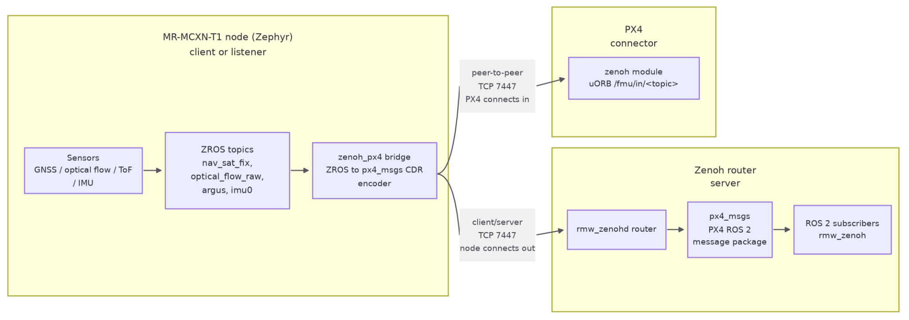

# MR-MCXN-T1 Zenoh Communication Modes
## Overview
This guide describes how to configure an MR-MCXN-T1 node to publish its sensor
samples as CDR-encoded `px4_msgs` over zenoh. The `zenoh_px4` bridge encodes each
ZROS sensor sample as a CDR `px4_msgs` payload and publishes it on
`<domain>/fmu/in/<topic>/...` over zenoh-pico. The MR-MCXN-T1 node supports two link
topologies that are covered by this document (the CDR wire payload is
byte-identical in both):

- client/server — the MR-MCXN-T1 node is a zenoh client that connects to an
  zenoh router (the server), typically on a Linux host / NavQ95 A55 core running Linux. The samples
  then appear as native ROS 2 topics to any `rmw_zenoh` application.
- peer-to-peer — a direct, router-free link to PX4. Here the MR-MCXN-T1 node is the
  listener and PX4 connects to it; the samples are fused into PX4's uORB.
  There is no ROS 2 graph discovery; only the CDR payload matters.

It also lists general commands for checking the current network interface, ROS 2 and the zenoh state.

## Topology


## Prerequisites
- Build the MR-MCXN-T1 GNSS / OFLO / IO application and flash it on MR-MCXN-T1. Follow these MR-MCXN-T1 build and flash [steps](https://github.com/nxp-robotics/robotics-docs/blob/robotics-0.7.0/platforms/mr-mcxn-t1/getting-started/mr-mcxn-t1-quick-start.md).
- The end-device the MR-MCXN-T1 node is communicating with, depending on the setup:
  - Zenoh router (zenoh server) running on a Linux host / NavQ95 A55 core running Linux. If NavQ95 A55 is used, follow these ROS2 setup [steps](../../../mr-navq95/middleware/ros2/ros2-multinode.md).
  - PX4 device (zenoh peer) running on RT1176, Tropic, NavQ95 M7 core.
- The MR-MCXN-T1 node's Ethernet interface must have an IP address on the same subnet as the server/peer it communicates with (rmw_zenoh, PX4 target device).

## Default MR-MCXN-T1 node configuration and general commands to check its current state

Each application ships with a different static IP address:

| Application | MR-MCXN-T1 node IP | Zenoh mode | Locator |
|---|---|---|---|
| `gnss` | `10.58.0.13/16` | `client` | `tcp/10.58.0.1:7447` |
| `optical_flow` | `10.58.0.12/16` | `peer` | `tcp/0.0.0.0:7447` |
| `io_exp` | `10.58.0.14/16` | `client` | `tcp/10.58.0.1:7447` |

The mode and the locator are runtime parameters set from the shell; the values
above are only the power-on defaults supplied by the application `prj.conf`.
A `config net` change is staged only — the session is reopened on the explicit
`zenoh_px4 restart`.

### Network interface commands
Check the current network interface status (such as the IP address and the link state)
```bash
net iface
```
Confirm `oper=UP, carrier=ON` and `100 Mbits full-duplex` before anything else.

Network interface stats
```bash
net stats
```

Show the active network connections — look for an `ESTABLISHED` entry to port `7447`:
```bash
net conn
```

### ZROS commands
List every ZROS topic on the MR-MCXN-T1 node
```bash
zros topic list
```

Show which ZROS nodes are running (`zenoh_px4` must be present)

```bash
zros node list
```

Inspect the ZROS topics (example: OFLO application)
```bash
zros topic echo optical_flow_raw
zros topic info optical_flow_raw
```

### Zenoh commands
Check whether the zenoh is running
```bash
zenoh_px4 status
```

## Scenario 1: MR-MCXN-T1 node (client) - Zenoh router (server)
In client mode the MR-MCXN-T1 node connects to a remote zenoh router (`rmw_zenohd`), so
the `<ip>:<port>` given to `config net client` is the remote router address.
The MR-MCXN-T1 node appears in the ROS 2 graph and PX4 (or any ROS 2 consumer) reaches it
through the router.

Check the zenoh configuration.
```bash
zenoh_px4 config show
```
Expected `config show` output: `mode: client`, the configured locator, and `running: 1`.

If the mode is not in `client` mode, run (or adapt per the locator IP address):
```bash
zenoh_px4 config net client tcp/10.58.0.1:7447
```

Start the communication
```bash
zenoh_px4 start
```

Start the communication on the other device (the server) and confirm MR-MCXN-T1 topics are visible there.

## Scenario 2: MR-MCXN-T1 node (peer) - PX4 (peer)
PX4's zenoh module glue (`ZENOH::setupSession()`) only ever inserts the zenoh
`MODE` and `CONNECT` config keys; it never inserts `LISTEN`. So a stock PX4 can
only be a connector in peer mode — it cannot open a listening peer transport.
To make a direct peer link work without patching PX4, the roles are reversed
from the usual embedded pattern: the MR-MCXN-T1 node is the LISTENER and PX4 connects
to it. zenoh-pico supports this on the MR-MCXN-T1 node side via `Z_FEATURE_UNICAST_PEER`
plus the `LISTEN` config key.
Semantic caveat (peer mode). Unlike PX4, where `net peer <ip>:<port>` is the
REMOTE connect target, here peer mode makes the MR-MCXN-T1 node the LISTENER, so the
`<ip>:<port>` is this MR-MCXN-T1 node's LOCAL bind/listen address. Leave it at
`tcp/0.0.0.0:7447` to accept on all interfaces, or pin it to the MR-MCXN-T1 node's own
address (`tcp/10.58.0.12:7447` for optical_flow, `tcp/10.58.0.13:7447` for
gnss) to bind a single interface.

Check the zenoh configuration.
```bash
zenoh_px4 config show
```
Expected `config show` output: `mode: peer`, locator `tcp/0.0.0.0:7447`, and `running: 1`.

If the mode is not in `peer` mode, run
```bash
zenoh_px4 config net peer tcp/0.0.0.0:7447
zenoh_px4 restart
```
Start the communication
```bash
zenoh_px4 start
```

Start the communication on the other device (the peer) and confirm MR-MCXN-T1 topics are visible there.

### PX4 steps (in communication with MR-MCXN-T1 node)
The key parameters must match on both sides, otherwise the key match silently
breaks and no sample is ever delivered:
- `ZENOH_DOMAIN_ID` == `CONFIG_SYNAPSE_ZENOH_PX4_DOMAIN_ID` (both default 0).
- `ZENOH_KEY_TYPE_HASH` == `CONFIG_SYNAPSE_ZENOH_PX4_RIHS_HASH` (both default `y`).

There is a known limitation on PX4: the Zenoh communication is not working with the standard publishers/subscribers default configuration. It needs to be trimmed.
`sensor_optical_flow` and `distance_sensor` ship stock in `dds_topics.yaml` (no
PX4 rebuild). `sensor_gps` / `sensor_mag` must be added under `subscriptions:`
and PX4 rebuilt.
Run these commands on PX4 NSH shell:
```bash
zenoh stop
cd /fs/microsd/zenoh
echo -n "" > pub.csv
echo -n "" > sub.csv

(for oflo)
zenoh config add subscriber /fmu/in/distance_sensor distance_sensor
zenoh config add subscriber /fmu/in/sensor_optical_flow sensor_optical_flow

(for gnss)
zenoh config add subscriber /fmu/in/sensor_gps sensor_gps
```

Check the current Ethernet configuration on PX4. Make sure the IP address is on the same subnet as the MR-MCXN-T1 node and change it if necessary:
```bash
ifconfig

ifconfig eth0 10.58.0.10 netmask 255.255.0.0
```

Configure the zenoh network peer connection with the MR-MCXN-T1 node IP address and port.
Example command for communication with the MR-MCXN-T1 OFLO (optical flow) application:
```bash
zenoh config net peer tcp/10.58.0.12:7447#iface=eth0
```

Start the communication
```bash
zenoh start
```

Monitor the topics in real time
```bash
uorb top sensor_optical_flow distance_sensor
```

Listen the topics
```bash
listener distance_sensor
listener sensor_optical_flow
```

## Additional Notes

### Enabling UART messaging on the Holybro DroneCAN H-RTK F9P Helical (MR-MCXN-T1 IO application use case)
The MR-MCXN-T1 IO is connected, through UART1, to the Holybro DroneCAN H-RTK F9P Helical UART port in order to receive GNSS packets. The following steps are needed on the Holybro DroneCAN H-RTK F9P Helical to enable UART messaging because it is silent by default. This is a one-time receiver configuration, applied over the module's USB port — which connects directly to the u-blox ZED-F9P and enumerates as a COM port — and written to the receiver's flash so that it survives a power cycle.

1. Connect the F9P's USB port to the host and open u-center (classic, 22.07 or
   newer — not u-center 2, which targets M10/X20 receivers).
2. Select `Receiver -> Port ->` the F9P's COM port. The baud rate is irrelevant over
   USB CDC. Confirm the green data-flow indicator at the bottom right.
3. Open `View -> Generation 9 Configuration View`. This is the CFG-VALSET editor used
   by the F9 generation.
4. Set the configuration keys below. For each key, tick RAM, BBR and Flash
   in the Layers checkboxes before applying, then press
   Load into Configuration / Set.

   | Configuration key | Value | Notes |
   |---|---|---|
   | `CFG-MSGOUT-UBX_NAV_PVT_UART2` | `1` | Required. The only message the MR-MCXN-T1 node consumes |
   | `CFG-UART2-ENABLED` | `1` | Verify; usually already set |
   | `CFG-UART2-BAUDRATE` | `38400` | Verify; must match the MR-MCXN-T1 node's `current-speed` |
   | `CFG-UART2INPROT-UBX` | `1` | Verify; required for the MR-MCXN-T1 node to query the receiver |
   | `CFG-UART2OUTPROT-UBX` | `1` | Verify; required for the receiver to answer |
   | `CFG-UART2OUTPROT-NMEA` | `0` | Optional; keeps the port free of unparsed NMEA |