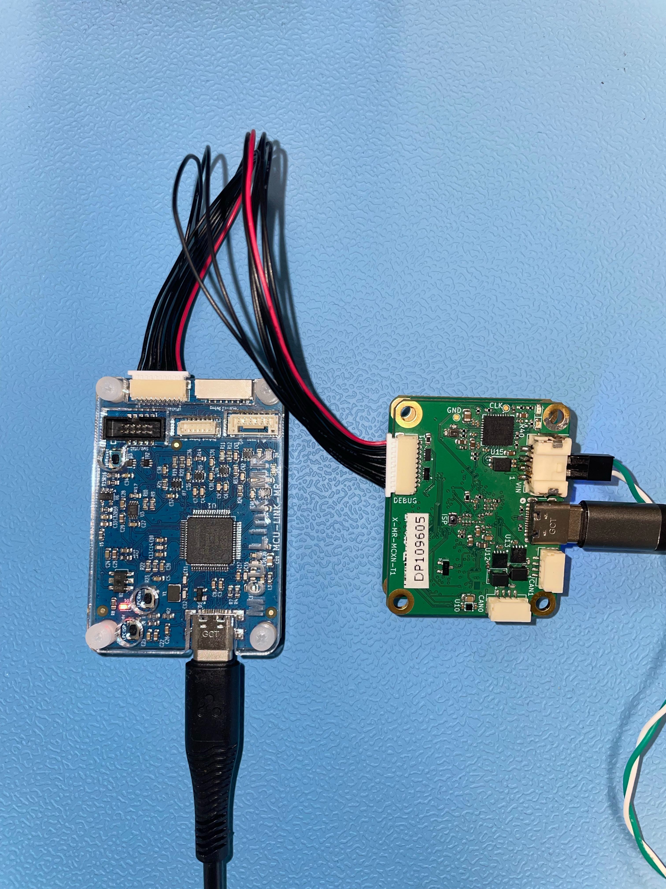

# MR-MCXN-T1 — Deploy and Run Quick Start

Including the MR-MCXN-T1-OFLO, MR-MCXN-T1-GNSS and MR-MCXN-T1-IO shield variants.

## Overview
This guide explains how to obtain MR-MCXN-T1 firmware, either prebuilt or built from source with the NXP Robotic Platforms SDK, and how to flash it using NXP LinkServer. It applies to both Zephyr and Cerebri (CogniPilot) stacks.

Two application stacks are available, both built via `west sdk build --stack`:
| Stack | `--stack` | What it is | Typical use |
|-------|-----------|------------|-------------|
| Zephyr | `zephyr` (default) | Stock Zephyr samples for this board | Peripheral bring-up and validation |
| Cerebri (CogniPilot) | `cerebri` | CogniPilot ROS 2 / zenoh sensor-node apps | Running the board as a robotics sensor node |

Each build produces two images — the MCUboot bootloader and the signed
application — which must be flashed to different addresses.

## Download or build the artifacts

Every platform assumes the images are already available — either downloaded or built with the SDK.

- Docker required. Downloading and building are done inside a Docker container built from the SDK's `Dockerfile` — see the [robotics-sdk README](https://github.com/nxp-robotics/robotics-sdk/blob/robotics-0.7.0/README.md) for how to set it up. All `west` commands are assumed to run inside that container.
- The SDK builds/downloads images but does not flash them — deployment is done with each platform's native tool.
- Where do the artifacts land? `<west topdir>` is the west workspace root — the directory containing `.west/`, created by `west init`. The `bin/` directory is created next to the `robotics-sdk/` clone, not inside it:
   ```
   <west topdir>/
   ├── .west/
   ├── robotics-sdk/     <- the SDK clone (west init -l)
   ├── build/                <- west sdk build intermediates
   └── bin/mr-mcxn-t1/       <- final artifacts land here
   ```

```sh
# prebuilt (fastest)
west sdk download --platform mr-mcxn-t1      # lands in <west topdir>/bin/mr-mcxn-t1/

# or build from source
west sdk build --platform mr-mcxn-t1 [...]  # lands in <west topdir>/{build,bin}/...
```

### Cerebri (CogniPilot) application
Besides the stock Zephyr samples, the MR-MCXN-T1 can run Cerebri, the CogniPilot flight/robotics application layer, built with the Cerebri stack. Each Cerebri app maps to a specific shield, and the SDK injects the matching shield overlay automatically — so `--shield` is not passed:

| App | Implied shield |
|-----|----------------|
| `optical_flow` | `oflo` (optical-flow shield) |
| `gnss` | `f9p` (u-blox F9P GNSS shield) |
| `io_exp` | `io_exp` (I/O expander) |

Build (or download) a Cerebri app:

```sh
# prebuilt
west sdk download --platform mr-mcxn-t1

# or build a specific Cerebri app from source
west sdk build --platform mr-mcxn-t1 --stack cerebri optical_flow
west sdk build --platform mr-mcxn-t1 --stack cerebri            # all Cerebri apps
```

For MR-MCXN-T1 the platform is `mr-mcxn-t1`. Run `west sdk list` for the authoritative list.

More details on how to build the examples can be found in the [robotics-sdk README](https://github.com/nxp-robotics/robotics-sdk/blob/robotics-0.7.0/README.md).
## What to flash

Every MR-MCXN-T1 example is a sysbuild build producing two images. The bootloader is typically programmed once, and during normal development, only the application image needs to be updated.

| Image | Build path (sysbuild domain) | Collected as | Absolute flash address |
|-------|------------------------------|--------------|------------------------|
| MCUboot bootloader | `build/mr-mcxn-t1/<stack>/<shield>/<example>/mcuboot/zephyr/zephyr.bin` | `mcuboot.bin` | `0x10000000` (flash base = `boot_partition`, 80 KB) |
| Signed application | `build/mr-mcxn-t1/<stack>/<shield>/<example>/<domain>/zephyr/zephyr.signed.bin` | `zephyr.signed.bin` | `0x10014000` (flash base + `slot0_partition` offset `0x14000`) |


Collected copies also appear under `<west topdir>/bin/mr-mcxn-t1/<stack>/<shield>/<example>/` as `mcuboot.bin` and `zephyr.signed.bin`. 

Example:
```
<west topdir>/bin/mr-mcxn-t1/cerebri/oflo/optical_flow/{mcuboot.bin, zephyr.signed.bin}
<west topdir>/bin/mr-mcxn-t1/cerebri/f9p/gnss/{mcuboot.bin, zephyr.signed.bin}
<west topdir>/bin/mr-mcxn-t1/cerebri/io_exp/io_exp/{mcuboot.bin, zephyr.signed.bin}
```

> ⚠️ Flash the signed application (`zephyr.signed.bin`) at the slot0 address `0x10014000`, not the raw `zephyr.bin` at flash base. MCUboot lives at flash base and chainloads the signed app in slot0. Writing an unsigned image at `0x10000000` will not boot.\
> ℹ️ The MCUboot bootloader is identical in layout across stacks; on a board that already has the bootloader only `zephyr.signed.bin` needs re-flashing at `0x10014000` when switching between a Zephyr sample and a Cerebri app (as long as both were signed with the same key set).

## Required hardware and connection setup

- MR-MCXN-T1 base board and USB cable into the board's native USB-C connector, for power supply.
- MR-MCXN-T1 shield variant (OFLO, GNSS, or IO) mounted on the MR-MCXN-T1 board.
- MCU-Link-MR used for flash / debug and USB cable for power supply. This connection can be used for serial console output as well. It enumerates as `/dev/ttyACM0` (Linux/macOS) or `MCU-Link VCom Port (COM*)` (Windows) for the CDC-ACM console.
- 10-Pin SH Debug cable to connect the MCU-Link-MR (Pixhawk Debug Full 10 port) to the MR-MCXN-T1 base board (DEBUG port).




## Flash with LinkServer
The LinkServer can be installed from [here](https://www.nxp.com/design/design-center/software/development-software/mcuxpresso-software-and-tools-/linkserver-for-microcontrollers:LINKSERVER). Make sure it is installed correctly and visible by running `LinkServer -v` on a terminal.

It is possible to update the firmware of the MCU-Link-MR debugger before flashing, in order to detect the connection properly. To do so, follow the steps from the official documentation.

Open a terminal and follow these steps in order to flash the MR-MCXN-T1:

1. Flash the bootloader

   ```sh
   LinkServer flash MCXN947 load --addr 0x10000000 mcuboot.bin
   ```

2. Flash the signed app into slot0

   ```sh
   LinkServer flash MCXN947 load --addr 0x10014000 zephyr.signed.bin
   ```

   Use the absolute address (flash base + slot offset), not the bare partition offset. On Windows the LinkServer path is e.g. `C:\NXP\LinkServer_26.6.137\LinkServer`.

3. Watch the MCU-Link-MR console for serial output

   ```sh
   screen /dev/ttyACM0 115200      # or: minicom / tio / picocom
   ```

   MCUboot boots, validates the slot0 image, and chainloads it; sample output appears on the CDC-ACM console.

> ⚠️ Two gotchas: \
>(a) J-Link's connector does not fit some MR-MCXN-T1 units — use MCU-Link + LinkServer.\
>(b)`LinkServer flash` has no remote mode, so run it on the host physically wired to the board (only its gdbserver is network-facing).

