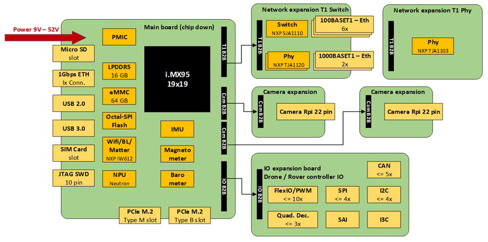

# MR-NavQ95 Hardware Architecture and Reference Design

The MR-NavQ95 is the vehicle-computer reference design of the NXP Mobile Robotics family. It combines a high-performance application processor, a real-time control core, on-device AI acceleration, and automotive-grade connectivity on a single compact board, so that a drone or mobile robot can run its perception, autonomy, and real-time control from one validated compute platform. This application note describes the system hardware architecture, the main functional subsystems, and the hardware integration considerations for engineers designing the MR-NavQ95 into a product.

This document is hardware focused. It describes the architecture and the role of each subsystem rather than the pin-level connector detail. For connector pinouts, net names, and i.MX 95 pad assignments, see the [MR-NavQ95 hardware reference](../../user-manual/hardware.md). Software bring-up, image flashing, and configuration are covered in the [MR-NavQ95 User Manual](../../user-manual/index.md) and the NXP Robotic Platforms SDK documentation.

## 1. Introduction

The MR-NavQ95 integrates the main NXP building blocks of a robotics compute node onto one board and a small set of expansion boards, so that compute, perception, connectivity, and real-time control can be evaluated and reproduced on validated hardware. It is intended as a starting point that customers adapt for their own autonomous-vehicle products.

The board is organized around the NXP i.MX 95 applications processor and three expansion boards that extend it with cameras, robotics I/O, and automotive Ethernet. A typical product would carry forward the i.MX 95 compute core and the subset of interfaces required by the target vehicle, re-laying the board to its own mechanical and electrical constraints.

## 2. System hardware architecture

The functional block diagram below shows how the i.MX 95 compute core connects to on-board memory, connectivity, and sensors, and to the camera, IO, and T1-switch expansion boards over board-to-board connectors.

Figure 1. MR-NavQ95 functional block diagram

At the system level the design is partitioned into:

- Compute core: the i.MX 95 applications processor with its LPDDR memory, boot and mass storage, and the on-chip Neutron NPU.
- Connectivity: wireless (Wi-Fi, Bluetooth, Matter, and 802.15.4) and wired Ethernet, including the automotive 100/1000BASE-T1 subsystem on the T1-switch expansion board.
- Sensing and perception: the on-board inertial, magnetometer, and barometric sensors, and the MIPI CSI-2 camera inputs on the camera expansion board.
- Robotics I/O: the CAN-FD, PWM, serial, I2C, and audio interfaces on the IO expansion board that connect the board to a vehicle.
- Power: the wide-range input stage and the on-board rails derived from it.

Each subsystem is described in the following sections. The physical connector that carries each interface, together with its pinout, is listed in the [hardware reference](../../user-manual/hardware.md); it is not repeated here.

## 3. Compute core

The compute core is the NXP i.MX 95 applications processor, a heterogeneous multicore SoC. It combines six Arm Cortex-A55 application cores for the Linux compute stack and robotics middleware, a Cortex-M7 real-time core for hard real-time control, and a Cortex-M33 System Manager. A single device therefore covers both the application and the real-time domains of a robot, with inter-core messaging between the Cortex-A and Cortex-M domains.

The on-chip NXP Neutron neural processing unit (NPU) provides machine-learning inference for the perception and AI workloads running on the Cortex-A cores. For heavier vision workloads, the board can host a discrete NPU module on one of its M.2 slots; see [Section 7, Expansion and acceleration](#7-expansion-and-acceleration).

The processor boots from and runs against the board's memory subsystem: LPDDR system memory, eMMC and octal-SPI flash for boot and mass storage, and a microSD slot for removable media. The boot source is selected by the boot-mode switch; the switch settings are documented in the [hardware reference](../../user-manual/hardware.md#boot-switch-sw2).

## 4. Connectivity

### 4.1 Wireless

Wireless connectivity is provided by an NXP combo radio offering Wi-Fi, Bluetooth, and Matter, together with an NXP 802.15.4 radio for Thread and Zigbee. These links carry telemetry, command, and data-offload traffic for the robot.

### 4.2 Automotive Ethernet

Wired networking is built around automotive Ethernet. In addition to gigabit Ethernet on the main board, the T1-switch expansion board (MR-NAVQ95E-T1S) adds a managed automotive-Ethernet switch based on the NXP SJA1110. The switch connects to the i.MX 95 over SGMII (the host port) and exposes:

- two 1000BASE-T1 ports through NXP TJA1120 PHYs, and
- six 100BASE-T1 ports on the SJA1110 internal PHYs.

This forms the time-sensitive-networking backbone that links the MR-NavQ95 to distributed sensor nodes and to the flight controller. The port assignments and connector types are listed in the [hardware reference](../../user-manual/hardware.md#t1-ethernet-switch-board); the usage and software configuration of the Ethernet subsystem are covered in the [Ethernet Application Note](../ethernet/index.md).

## 5. Sensing and perception

### 5.1 On-board sensors

The main board carries an on-board inertial measurement unit, a magnetometer, and a barometric pressure sensor for motion, heading, and altitude estimation. These support state estimation when the MR-NavQ95 runs the flight or motion stack on its Cortex-M7 core.

### 5.2 Camera interface

The camera expansion board brings the i.MX 95 MIPI CSI-2 inputs out to standard Raspberry Pi-style camera connectors, feeding the on-chip image signal processor and the vision pipeline. Camera selection, connection, and streaming are described in the [Camera Application Note](../camera/index.md); the connector pinouts are in the [hardware reference](../../user-manual/hardware.md#camera-expansion-board).

## 6. Robotics I/O

The IO expansion board adapts the i.MX 95 to the interfaces a vehicle needs: CAN-FD buses, PWM motor and servo outputs, UART telemetry, GPS and safety inputs, I2C, and an audio codec. Most of these connectors follow the Dronecode DS-009 connector standard, so standard cables fit. The connector set, pin order, and the DS-009 markings are documented in the [hardware reference](../../user-manual/hardware.md#io-expansion-board).

> Note: The 5 V pin of every JST-GH connector is a filtered, ESD-protected output of the 5 V system rail. These pins are outputs; the board must be powered through the main power input only.

## 7. Expansion and acceleration

The main board provides two PCIe M.2 slots. These can host mass storage or a discrete NPU module for accelerated vision and generative-AI workloads that exceed the headroom of the on-chip Neutron NPU. The expansion of the board into cameras, robotics I/O, and automotive Ethernet is handled by the three board-to-board expansion boards described above.

## 8. Power

The board accepts a wide input range suitable for typical robotics batteries and derives the regulated system rails required by the compute core, expansion boards, and connector outputs from it. The input range, power budget, and the ADC channels used to monitor the input and the derived rails are documented in the [hardware reference](../../user-manual/hardware.md#notes). Input limits, protection behavior, and regulator ratings must be confirmed against the released schematic for the board revision in use.

> Warning: Never feed power into a 5 V output pin of a connector. Power the board through its main power input only.

## 9. Hardware integration and bring-up

- Confirm the main board and expansion board part numbers and revisions.
- Confirm the input supply range and polarity against the released schematic before applying power.
- Verify connector orientation and mating; the connector pinouts are in the [hardware reference](../../user-manual/hardware.md).
- Bring the board up using a current-limited supply, and verify the expected rails before connecting the node to the wider robotic system.
- Observe electrostatic-discharge precautions and provide mechanical support and strain relief appropriate to the installation.

Software bring-up, image flashing, and device-tree overlays are covered in the [MR-NavQ95 User Manual](../../user-manual/index.md).

## 10. Schematic, board layout, and bill of materials

This application note provides a system-level hardware overview and should be used together with the released design files. Electrical limits, connector pin assignments, signal direction, power-domain relationships, and assembly options must be confirmed against the released schematic and bill of materials for the applicable board revision. The schematics, board layout, and design files are published in the [MR-NAVQ95 repository](https://github.com/NXP-Robotics/MR-NAVQ95).

## 11. Abbreviations

| Acronym | Description |
|---------|-------------|
| AI | Artificial intelligence |
| CAN FD | Controller Area Network Flexible Data-rate |
| CSI | Camera Serial Interface |
| eMMC | Embedded MultiMediaCard |
| MCU | Microcontroller unit |
| MIPI | Mobile Industry Processor Interface |
| NPU | Neural processing unit |
| PCIe | Peripheral Component Interconnect Express |
| PHY | Physical-layer transceiver |
| ROS 2 | Robot Operating System 2 |
| SAI | Serial audio interface |
| SGMII | Serial Gigabit Media-Independent Interface |
| SoC | System on chip |
| SPI | Serial Peripheral Interface |
| TSN | Time-Sensitive Networking |
| UART | Universal asynchronous receiver-transmitter |

## 12. References

- [MR-NavQ95 hardware reference](../../user-manual/hardware.md) — connectors, pinouts, and i.MX 95 pad assignments
- [MR-NavQ95 User Manual](../../user-manual/index.md) — software bring-up, flashing, and configuration
- [MR-NAVQ95 repository](https://github.com/NXP-Robotics/MR-NAVQ95) — schematics, board layout, and bill of materials
