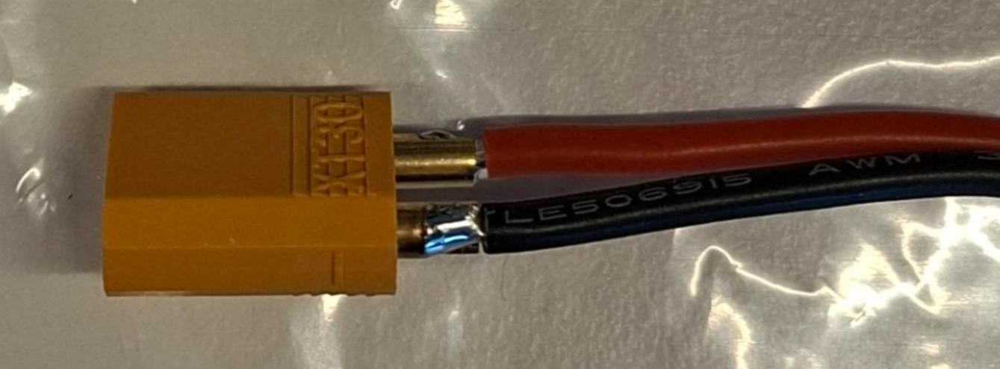
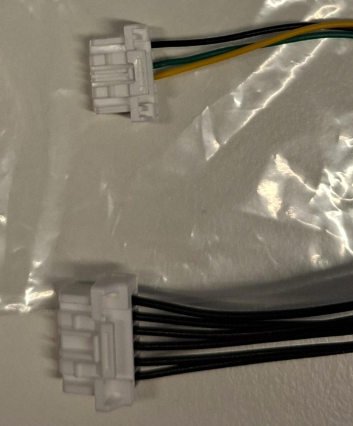
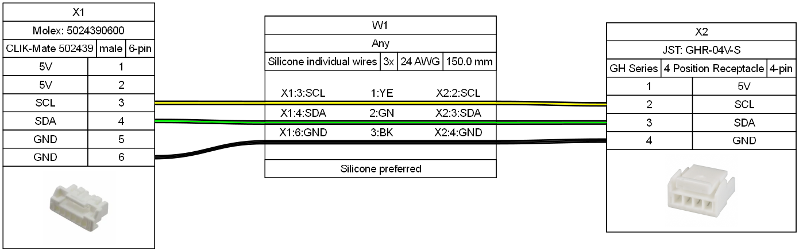

# Cable issues in initial MR-NavQ95 kits

Two cabling issues were identified in the initial batch of MR-NavQ95 units.
Because of urgent demand, a small number of initial units shipped with these
deficiencies rather than being delayed. This product notice describes the
affected cables, how to identify them, the temporary corrective actions a user
can apply, and how to obtain replacement cables from NXP.

> Warning: Inspect the XT30 power cable and the optional PM02DHV adapter cable
> included in the kit before powering the board. One cable has insufficient
> insulation at the solder joint and poses a short-circuit risk; the optional
> PM02DHV adapter cable is incorrectly assembled and must not be used.

## 1. Requesting replacement cables from NXP

To receive replacement cables, contact
[uav.solutions@nxp.com](mailto:uav.solutions@nxp.com). Replacements are
shipped from NXP in a separate shipment as soon as they become available.

## 2. XT30 power connector: missing insulation

The back side of the XT30 power connector, where the wires are soldered to
the connector pins, should be covered with heat shrink or an equivalent
insulation. On the affected cables this insulation is missing and the solder
joints are exposed, which creates a short-circuit risk.

<figure>
  
</figure>

Figure 1. Affected XT30 power connector with exposed solder joints.

### 2.1 Temporary corrective action

Apply one of the following before powering the board:

- Wrap the exposed back side of the connector with vinyl electrical tape so
  that the two solder joints and bare wire sections are fully covered and
  cannot short to each other or to adjacent conductors.
- Desolder the wires, slide a short length of heat shrink over each wire,
  re-solder the wires to the connector, and shrink the tubing over the solder
  joints.

The electrical-tape solution is intended as a temporary measure. For a
permanent fix, request a replacement cable or rework the connector with heat
shrink as described above.

## 3. PM02DHV adapter cable: incorrect assembly

The kit includes an optional cable for adapting an MR-VMU-PM02DHV digital
power module (or a similar off-the-shelf PM02DHV module) so its I2C interface
can be read by the MR-NavQ95 I2C port. On the affected cables both connector
ends are incorrect, so the cable cannot be used as shipped and must be
discarded.

<figure>
  
</figure>

Figure 2. Incorrectly assembled PM02DHV adapter cable; both ends are wrong
and the cable must be discarded.

### 3.1 Temporary corrective action

To obtain a working I2C connection to the power module while waiting for a
replacement cable:

1. Obtain a standard PM02DHV power module. The module ships with its own
   cable to the 6-pin Molex CLIK-Mate connector on the module side.
2. Cut the cable that comes with the PM02DHV module to the required length.
3. Solder three JST-GH pre-crimped wires to the three I2C conductors (SCL,
   SDA, and GND) of the cut cable.
4. Insert the three pre-crimped wires into a 6-position JST-GH housing,
   following the pinout in the wiring diagram below.

JST-GH pre-crimped wires and housings are available from a number of online
retailers.

<figure>
  
</figure>

Figure 3. Wiring diagram for the PM02DHV-to-MR-NavQ95 I2C adapter cable.

### 3.2 Wiring summary

The adapter maps the PM02DHV side (X1, Molex CLIK-Mate 502439, 6-pin, male)
to the MR-NavQ95 I2C side (X2, JST GHR-04V-S, 4-pin). Only the three I2C
conductors (SCL, SDA, GND) are populated:

| Signal | X1 pin (PM02DHV side, Molex CLIK-Mate 6-pin) | Wire (W1, 24 AWG, 150 mm) | X2 pin (MR-NavQ95 side, JST-GH 4-pin) |
|---|---|---|---|
| SCL | 3 | 1: yellow | 2 |
| SDA | 4 | 2: green  | 3 |
| GND | 6 | 3: black  | 4 |

Silicone-insulated 24 AWG wire is recommended. Pin 1 (5 V) on the MR-NavQ95
JST-GH connector is left unconnected.

## 4. References

- [MR-NavQ95 overview](../../overview.md)
- [MR-NavQ95 hardware reference](../../user-manual/hardware.md)
- [MR-NavQ95 product page](https://www.nxp.com/design/design-center/development-boards-and-designs/MR-NAVQ95)
