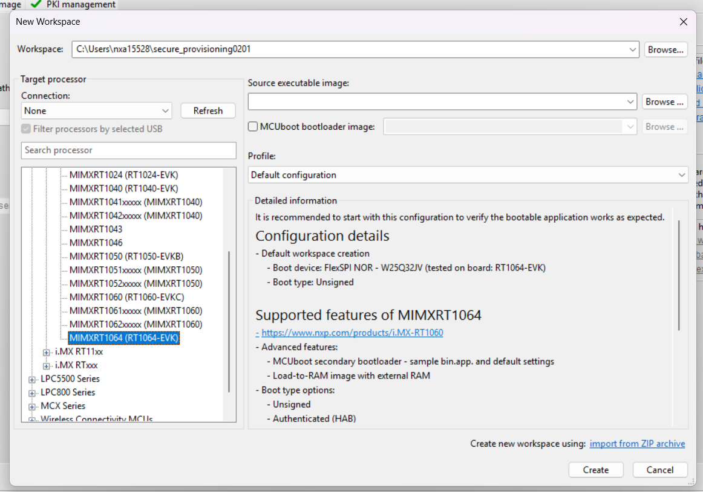
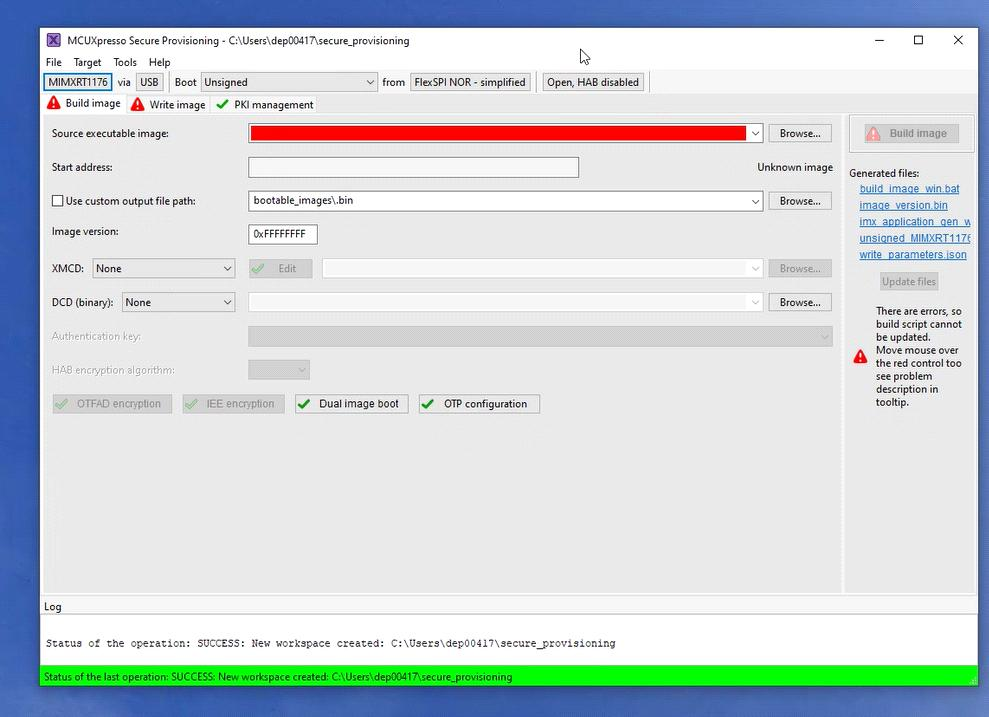
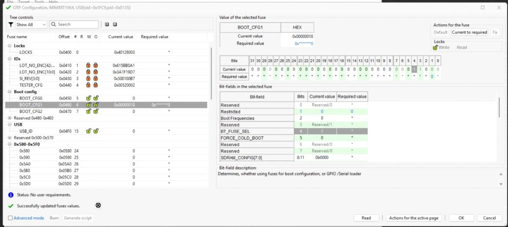
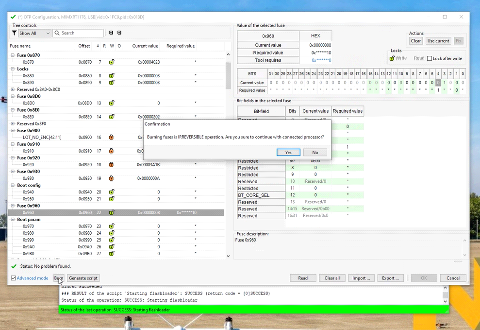
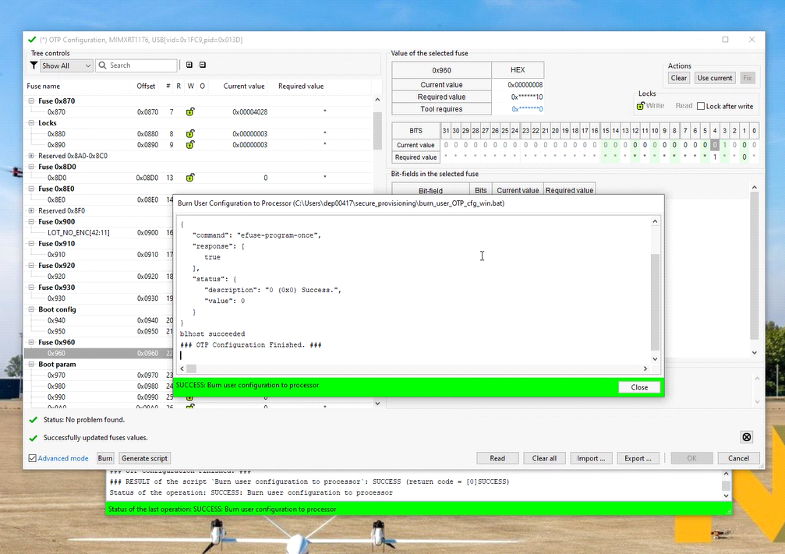
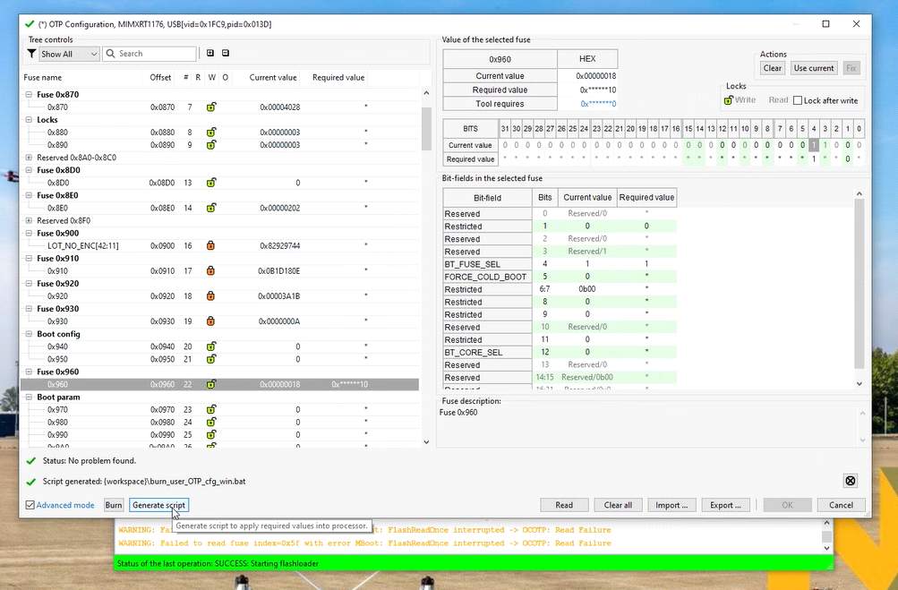
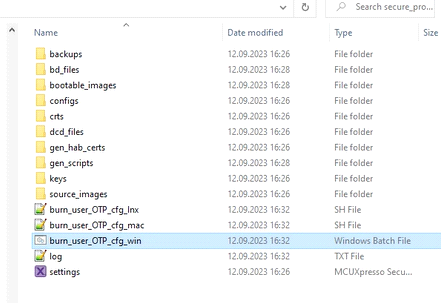

# Programming Boot Configuration Fuses on MR-VMU-Tropic

This application note describes how to configure and program the i.MX RT1064 boot-selection fuse used by the MR-VMU-Tropic design. It covers creating an MCUXpresso Secure Provisioning Tool workspace, selecting the BOOT_CFG1 fuse field, programming BT_FUSE_SEL to the required value, and generating a reusable programming script for new board builds.

> Important: MR-VMU-Tropic evaluation boards are supplied with the required fuse programming already completed. This procedure is intended for virgin board builds or boards fitted with a new, unprogrammed i.MX RT1064 device.

## 1. Scope and prerequisites

Use this procedure during initial bring-up of a newly manufactured MR-VMU-Tropic board or after fitting a new i.MX RT1064 processor. The procedure programs the boot configuration so that the device uses the fuse-defined boot settings expected by the platform.

> Warning: OTP fuse programming is irreversible. Confirm the selected processor, target board, and required fuse value before initiating the burn operation.

> Note: Some source screenshots were captured with an i.MX RT1176 workspace. The workflow is similar, but for MR-VMU-Tropic the MIMXRT1064 processor must be selected.

### 1.1 Required software and equipment

- NXP MCUXpresso Secure Provisioning Tool
- A host PC connected to the target using the supported debug and provisioning connection
- A powered MR-VMU-Tropic target containing an i.MX RT1064 device

### 1.2 Software download

Install the NXP MCUXpresso Secure Provisioning Tool from the [MCUXpresso Secure Provisioning Tool product page](https://www.nxp.com/design/software/development-software/mcuxpresso-software-and-tools-/mcuxpresso-secure-provisioning-tool:MCUXPRESSO-SECURE-PROVISIONING#downloads).

## 2. Create an i.MX RT1064 workspace

Start the MCUXpresso Secure Provisioning Tool.

In the New Workspace dialog, select the i.MX RT10xx series and then select MIMXRT1064 as the processor.

Select Create to create the workspace.

<figure>
  
</figure>

Figure 1. Select MIMXRT1064 when creating the provisioning workspace

## 3. Open the OTP configuration

After the workspace opens, select OTP configuration.

If the tool asks to prepare or initialize the workspace, select Yes and wait for the script to finish.

<figure>
  
</figure>

Figure 2. Open OTP configuration from the Secure Provisioning Tool workspace

## 4. Select the boot fuse field

In the OTP Configuration window, select BOOT_CFG1.

Locate the BT_FUSE_SEL bit-field and set its Required value to 1.

Enable Advanced mode using the control in the lower-left corner.

<figure>
  
</figure>

Figure 3. Select BOOT_CFG1 and set BT_FUSE_SEL to the required value of 1

> Warning: Only program the fuse value documented for this application. Do not copy other fuse values visible in screenshots.

## 5. Program the fuse

With the target connected and the required value reviewed, select Burn.

The tool displays an irreversible-operation confirmation.

Select Yes only after confirming the target and configuration.

Wait for the operation to complete successfully.

<figure>
  
</figure>

Figure 4. Confirm the irreversible fuse-programming operation

## 6. Confirm completion

When the tool reports that OTP configuration has finished successfully, select Close.

<figure>
  
</figure>

Figure 5. Successful completion of the OTP programming operation

## 7. Generate a reusable programming script

Select Generate script.

The generated Windows batch file is placed in the Secure Provisioning Tool workspace.

The default workspace is located under `C:\Users\<username>\secure_provisioning` and the generated file is `burn_user_OTP_cfg_win.bat`.

This script can be used to program the same required fuse configuration on subsequent new boards.

<figure>
  
</figure>

Figure 6. Generate the fuse-programming script from the OTP configuration window

<figure>
  
</figure>

Figure 7. Example generated burn_user_OTP_cfg_win.bat file in the workspace

> Important: Before using a generated script in production, control it as a manufacturing artifact and verify that it was generated from the approved fuse configuration.

## 8. Completion criteria

- The operation completes without an error.
- The Secure Provisioning Tool reports successful OTP configuration.
- The generated script, if required, is retained with the controlled manufacturing files.

## 9. Abbreviations

| Acronym | Description |
|---------|-------------|
| BOOT_CFG | Boot configuration fuse field |
| BT_FUSE_SEL | Boot fuse selection bit |
| EVK | Evaluation kit |
| FMU | Flight management unit |
| MCU | Microcontroller unit |
| OTP | One-time programmable |
| VMU | Vehicle management unit |

## 10. References

- [MR-VMU-Tropic user manual](../../user-manual/configuring-the-hardware.md) — flashing the bootloader and application
- [MR-VMU-Tropic hardware architecture and reference design](../hardware-overview/index.md) — board hardware architecture
- [MCUXpresso Secure Provisioning Tool product page](https://www.nxp.com/design/software/development-software/mcuxpresso-software-and-tools-/mcuxpresso-secure-provisioning-tool:MCUXPRESSO-SECURE-PROVISIONING#downloads) — tool download and documentation
