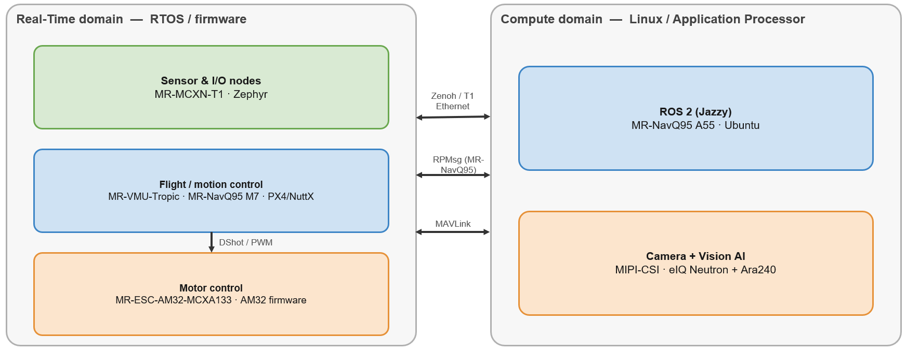
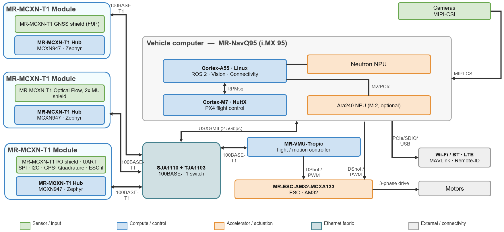
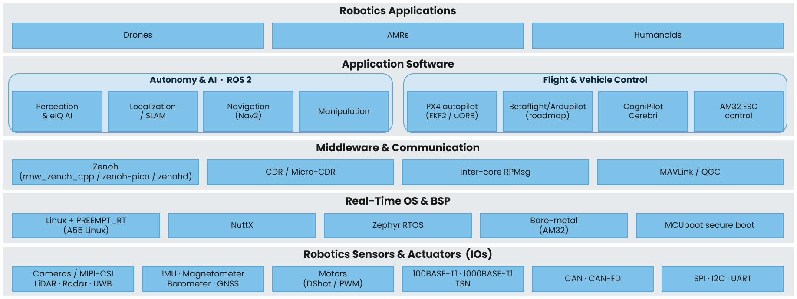
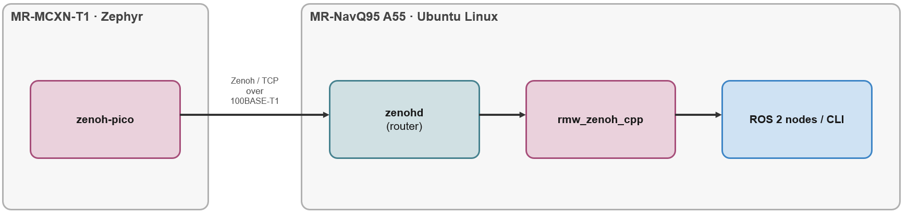
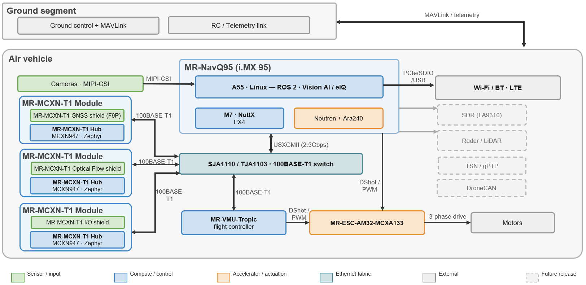
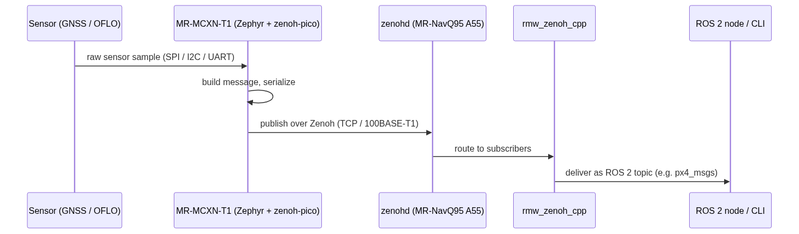
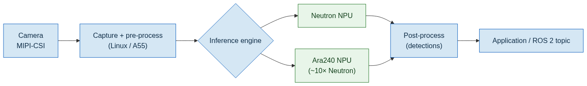
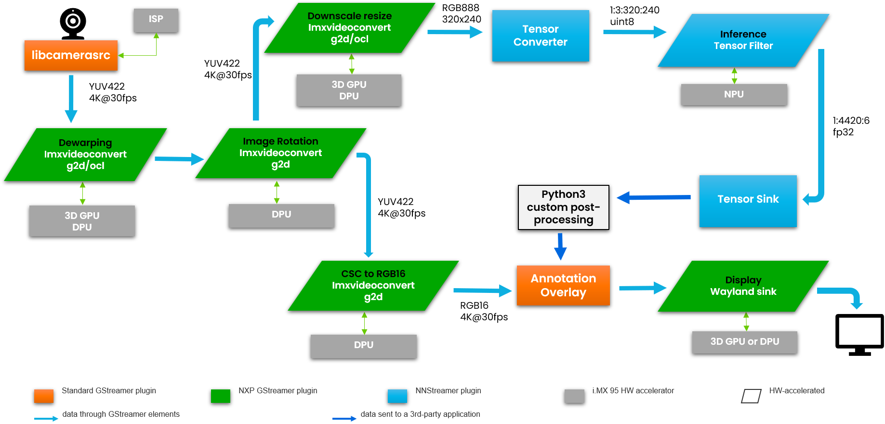

# System Level Integration Guide

NXP Robotic Platforms SDK v0.7.0

The NXP Robotic Platforms SDK provides software, reference configurations, and
documentation for building distributed robotics systems using NXP
compute, real-time control, sensing, connectivity, and motor-control
platforms.

This guide presents the system-level architecture of NXP Robotic Platforms SDK
v0.7.0. It explains how the supported platforms work together,
identifies the software and communication mechanisms used between them,
and describes the end-to-end data paths validated for this release.
Platform-specific hardware setup, software installation, flashing, and
configuration procedures remain in the corresponding user manuals and
application notes.

NXP Robotic Platforms SDK v0.7.0 primarily targets drone systems. The drone
architecture in this guide is a reference integration baseline rather
than a mandatory product architecture. Individual products may use a
subset of the platforms or replace particular components according to
their performance, safety, cost, size, weight, and fault-containment
requirements.

Only configurations explicitly marked Supported have been enabled
and validated within the stated v0.7.0 validation scope. Planned
elements illustrate intended roadmap direction and are not part of the
supported release.

> Note: Scope. NXP Robotic Platforms SDK v0.7.0 is primarily targeted at drones.
> Accordingly, the system-level architecture in this document is described from a
> drone perspective. The same building blocks, data fabric, and methods also apply
> to other robotics form factors such as AMRs and humanoids; where relevant this is
> noted, but the reference architecture and validation shown here are for drones.

## How to read this document

Status is shown consistently throughout, in both the tables and the
diagrams:

| Symbol      | Meaning                                      |
|-------------|----------------------------------------------|
| Yes     | Supported — enabled and validated in v0.7.0  |
| Planned | Planned — on the roadmap for a later release |
| —           | Not applicable to this platform              |

In the diagrams, solid boxes are supported in v0.7.0 and dashed/dimmed
boxes are planned.

## 1. Overview

The NXP Robotic Platforms SDK provides validated software for a family of
mobile-robotics boards that together cover the full compute-to-actuation
range of a robot. A typical NXP robot is built from two cooperating
software domains running across one or more boards:

- Compute domain (Linux / Application Processor) — the high-level
  "brain": ROS 2, the camera and vision pipeline, on-device AI
  inference, and connectivity. This runs on the Cortex-A cores of the
  MR-NavQ95 (i.MX 95), optionally accelerated by an Ara240 vision-AI NPU
  module.

- Real-time domain (RTOS / firmware) — the deterministic "reflexes":
  flight and motion control, sensor and I/O nodes, and motor control.
  This runs on the Cortex-M real-time core of the MR-NavQ95, on the
  MR-VMU-Tropic flight controller, on the MR-MCXN-T1 sensor/I-O nodes,
  and on the MR-ESC-AM32 electronic speed controller.

The two domains are joined by a common, ROS 2-native communication
fabric — ROS 2 over Zenoh on the Linux side, zenoh-pico on the
microcontroller nodes, and RPMsg between the cores of the i.MX 95 —
carried physically over 100BASE-T1 automotive Ethernet, CAN, and the
standard sensor buses (MIPI-CSI, SPI, I2C, UART).

<figure>
  
</figure>

Figure 1 — The two software domains of the NXP Robotic Platforms SDK and how they connect.

## 2. The platforms at a glance

The SDK supports four hardware platforms. The MR-NavQ95 is the system
compute host and can also run the real-time flight stack on its Cortex-M
core; the other three are dedicated real-time boards. For board
bring-up, flashing, and pin-level detail, follow the per-platform
documentation in the SDK repository (robotics-docs).

| Platform            | Silicon                          | Role in the system                                                                       | Domain(s)           |
|---------------------|----------------------------------|------------------------------------------------------------------------------------------|---------------------|
| MR-NavQ95           | i.MX 95 (A55, M7, and Neutron NPU) | Vehicle computer — perception, AI, ROS 2, connectivity; optional on-board flight control | Compute and Real-time |
| MR-VMU-Tropic       | Flight-controller SoC            | Flight / vehicle-management controller                                                   | Real-time           |
| MR-MCXN-T1          | MCX N (Cortex-M)                 | Sensor and I/O node on 100BASE-T1 Ethernet                                               | Real-time           |
| MR-ESC-AM32 | MCX A (Cortex-M)                 | Electronic speed controller (motor drive)                                                | Real-time           |
| Ara240 (add-on)     | Vision-AI NPU (M.2)              | Vision-AI accelerator for the MR-NavQ95                                                   | Compute             |

> Note: The Ara240 is an optional companion NPU module on the MR-NavQ95 M.2
> connector. The i.MX 95 on-SoC Neutron NPU provides AI inference on its own; the
> Ara240 adds headroom for heavier vision workloads. See the
> [eIQ Neutron NPU](../../platforms/mr-navq95/application-notes/eiq-neutron-npu/index.md) and
> [ARA-240 DNPU](../../platforms/mr-navq95/application-notes/ara-240-dnpu/index.md) Application Notes.

## 3. Hardware view

At the hardware level, an NXP drone is organized around the MR-NavQ95
vehicle computer as the central compute hub, a flight/motion controller
for deterministic control, sensor/I-O nodes distributed on automotive
Ethernet, and one or more ESCs driving the motors.

<figure>
  
</figure>

Figure 2 — System hardware topology (v0.7.0). The MR-NavQ95 hosts both the
Compute (A55) and Real-time (M7) domains; sensor nodes and the flight controller
share a 100BASE-T1 Ethernet fabric; ESCs are driven over DShot/PWM.

### Interconnects

| Interconnect                            | Where it is used                                   | Notes                                                                                                |
|-----------------------------------------|----------------------------------------------------|------------------------------------------------------------------------------------------------------|
| 100BASE-T1 Ethernet (SJA1110 and TJA1103) | Between MR-NavQ95, MR-VMU-Tropic, MR-MCXN-T1 nodes | The system data backbone; carries the Zenoh fabric between nodes. See the Ethernet Application Note. |
| RPMsg                                   | Between the i.MX 95 A55 and M7 on the MR-NavQ95    | Inter-core messaging inside the vehicle computer.                                                    |
| MIPI-CSI                                | Cameras → MR-NavQ95                                | Camera capture into the vision pipeline. See the Camera Application Note.                            |
| CAN / CAN-FD                            | Auxiliary sensors, servos, peripherals             | Field bus for distributed nodes and payload devices.                                                 |
| DShot / PWM                             | Flight/motion controller → ESC                     | Motor-command protocol. DShot300 and DShot600 supported in v0.7.0.                                   |
| SPI / I2C / UART                        | On-board sensors and peripherals                   | Standard MCU sensor buses on the MR-MCXN-T1 shields and controllers.                                 |
| Wi-Fi / Bluetooth / LTE                 | MR-NavQ95                                          | Wireless connectivity for telemetry, command, and data offload.                                      |

## 4. Software layer model

The NXP Robotic Platforms SDK is organized as a set of layered software building
blocks spanning compute, communication, real-time control, and hardware
platforms. At the application level, the system is composed of two
complementary software domains: Autonomy & AI, responsible for
perception, decision making, and robot intelligence, and Flight &
Vehicle Control, responsible for deterministic sensing, state
estimation, and actuator control. These domains operate as cooperating
peers, exchanging information through the underlying communication
infrastructure while remaining logically independent of one another. As
a result, they are represented side-by-side in the layer model rather
than as higher and lower layers.

<figure>
  
</figure>

Figure 3 — The v0.7.0 software layer model. Autonomy & AI (ROS 2) and Flight &
Vehicle Control (PX4) are co-equal application software that talk through the
Connectivity & Data Fabric layer beneath them.

The layers, top to bottom:

- Robotics Applications — the robot mission and reference
  applications (v0.7.0 focus: drone).

- Application software (over the data fabric) — contains two equal
  groups: Autonomy & AI (ROS 2 nodes, perception / Vision AI) and Flight
  & Vehicle Control (PX4 autopilot with EKF2 / uORB, MAVLink).

- Connectivity & Data Fabric — Zenoh (rmw_zenoh_cpp / zenoh-pico /
  zenohd), CDR / Micro-CDR serialization, inter-core RPMsg, and the
  MAVLink router.

- Real-time OS & BSP — Linux (A55), NuttX (PX4), Zephyr RTOS, and
  MCUboot secure boot.

- Sensors, Actuators & Hardware — cameras (MIPI-CSI), GNSS / IMU /
  optical flow, 100BASE-T1 (SJA1110 / TJA1103) and CAN, motors (DShot /
  PWM).

> Note: Applicability. The layer model and the methods in this document are
> described for drones, but the same building blocks apply to other robotics form
> factors such as AMRs and humanoids — typically by adding autonomy packages
> (navigation, VSLAM) and additional sensors on the same fabric in a later release.

## 5. The communication fabric

The NXP Robotic Platforms SDK provides a unified data-sharing architecture across
Linux and microcontroller nodes while using the communication mechanism
best suited to each domain. Distributed sensor and application data are
exchanged through a Zenoh-based data plane, consisting of
rmw_zenoh_cpp for ROS 2 applications on the MR-NavQ95, zenohd as
the local Zenoh router, and zenoh-pico on resource-constrained
microcontroller nodes such as the MR-MCXN-T1. This enables supported
MCU-generated data to be consumed by Linux applications as standard ROS
2 topics without requiring a user-developed gateway application. Within
the heterogeneous i.MX 95 device, communication between the Cortex-A55
and Cortex-M7 cores is provided through RPMsg, while MAVLink is
used for flight-controller telemetry, status, and command exchange.

<figure>
  
</figure>

Figure 4 — The Zenoh-based ROS 2 fabric. A microcontroller node using zenoh-pico
interoperates directly with ROS 2 on the MR-NavQ95 through zenohd and rmw_zenoh_cpp.

> Note: For the exact configuration and validation of the T1-node Zenoh link
> (px4_msgs install, static T1 IP, SJA-switch network fixes, zenoh_px4 client-mode
> setup, and verification with `ros2 topic echo`), see the
> [ROS 2 Multinode Communication guide](../../platforms/mr-navq95/middleware/ros2/ros2-multinode.md).
> This document does not repeat those steps.

## 6. Reference architecture (drone)

The following reference architecture shows how the SDK components
combine for a drone — the primary target of v0.7.0. Solid boxes are
supported in v0.7.0; dashed/dimmed boxes are planned for a later
release.

The MR-NavQ95 hosts perception, AI, ROS 2, and connectivity on Linux
(A55) while running the PX4 flight stack on the real-time core (M7); an
MR-VMU-Tropic can serve as a dedicated flight controller. Sensor nodes
attach over 100BASE-T1 Ethernet, and the MR-ESC-AM32 drives the
motors.

<figure>
  
</figure>

Figure 5 — Drone reference architecture. Solid = v0.7.0; dashed = planned.
Radar/LiDAR, SDR, and TSN/gPTP/DroneCAN are on the roadmap.

> Note: Other form factors. An AMR or humanoid reuses the same MR-NavQ95
> compute, sensor nodes, connectivity, and ROS 2 baseline shown here; it typically
> adds autonomy packages (navigation, VSLAM) and further sensors on the same
> fabric. These additions are planned for a later release and are not part of the
> v0.7.0 validated scope.

Because the MR-NavQ95 is a heterogeneous i.MX 95 device, its Cortex-M7
real-time core runs the same PX4/NuttX flight stack as the
MR-VMU-Tropic. So, the MR-NavQ95 can serve as the companion computer and
the flight controller in a single board. Depending on drone complexity,
the architecture can therefore be built around a dedicated MR-VMU-Tropic
flight controller, around the MR-NavQ95 alone (compute and flight
control combined, reducing board count, size, and weight), or around
both MR-VMU-Tropic and MR-NavQ95 together. Simpler or space-constrained
vehicles benefit from consolidating onto the MR-NavQ95, while more
complex or higher-assurance vehicles may prefer a dedicated
MR-VMU-Tropic to keep the real-time flight control and the companion
compute on separate boards.

### Drone capability matrix (v0.7.0)

The capability matrix maps each software-layer component to the platform
that hosts it and its v0.7.0 status.

| Layer                                     | Component                                                                           | Platform                   | v0.7.0      |
|-------------------------------------------|-------------------------------------------------------------------------------------|----------------------------|-------------|
| Applications                              | Reference apps (Hover / Gesture), Vision AI / eIQ                                    | MR-NavQ95 (+ Ara240)       | Yes     |
| Application SW – Autonomy & AI            | ROS 2 (Jazzy), DDS, Zenoh                                                            | MR-NavQ95                  | Yes     |
| Application SW – Flight & Vehicle Control | PX4                                                                                 | MR-NavQ95, MR-VMU-Tropic   | Yes     |
|                                           | Betaflight                                                                          | MR-NavQ95, Tropic          | Planned |
|                                           | ArduPilot                                                                          | MR-NavQ95                  | Planned |
| Connectivity & Data Fabric                | Zenoh (rmw_zenoh_cpp / zenoh-pico / zenohd), CDR / Micro-CDR, RPMsg, MAVLink router | (all)                      | Yes     |
|                                           | TSN / gPTP, DroneCAN                                                                | MR-NavQ95, MCXN-T1         | Planned |
| Real-time OS & BSP                        | NuttX, Zephyr, Linux, MCUboot                                                       | MR-NavQ95, Tropic, MCXN-T1 | Yes     |
| Services & Drivers                        | MAVLink / Remote-ID, Camera (MIPI-CSI)                                              | MR-NavQ95                  | Yes     |
|                                           | Ethernet (SJA1110 and TJA1103), Wi-Fi / BT / LTE, ESC (AM32)                          | MR-NavQ95, ESC-AM32        | Yes     |
|                                           | SDR (LA9310)                                                                        | MR-NavQ95, MCXN-T1         | Planned |
| Hardware                                  | MR-NavQ95, MR-VMU-Tropic, MR-ESC-AM32, MR-MCXN-T1, Ara240                   | (all)                      | Yes     |
|                                           | Radar / LiDAR, Dual Ara240                                                          | MR-NavQ95, sensors         | Planned |

## 7. End-to-end data flows

This section describes the data flows that the SDK enables in v0.7.0.

### 7.1 Distributed sensor data (MR-MCXN-T1)

A sensor connected to an MR-MCXN-T1 node (optical flow, GNSS, or the I/O
expander) is encoded as a PX4 message and published over the Zenoh
fabric. On the compute host it can be consumed as a normal ROS 2 topic
by a node on the MR-NavQ95 A55, and on the flight-control side it can be
consumed by a PX4 flight controller.

<figure>
  
</figure>

Figure 6 — Distributed sensor to ROS 2 data flow.

The following table records which of these consumers are validated as of
the current release. It is the authoritative view of the supported
MR-MCXN-T1 sensor data paths — the MCXN-T1 node validated setup matrix.

| Setup variant | Data path | MCXN-T1 OFLO (optical-flow shield) | MCXN-T1 F9P / GNSS (F9P GNSS shield) | MCXN-T1 IO (IO expander shield) |
|---------------|-----------|:----------------------------------:|:------------------------------------:|:-------------------------------:|
| Routed Zenoh → ROS 2 and PX4 (NavQ95) | T1 node → TCP client → Zenoh router (NavQ95 Ubuntu / A55). Router serves both consumers at once: topics visible to ROS 2 on the A55 and routed over Ethernet to PX4 | ✅ | ✅ | ✅ |
| Routed Zenoh → ROS 2 only (NavQ95, no PX4) | T1 node → TCP client → Zenoh router (NavQ95 Ubuntu / A55) → ROS 2 on A55 (`ros2 topic list` / `ros2 topic echo`) — no PX4 connected | ✅ | ✅ | ✅ |
| Peer-to-Peer PX4 → MavLink → QGC (NavQ95 M7) | T1 node ↔ zenoh peer-to-peer PX4 (NavQ95 M7) → MAVLink over RPMsg → mavlink-router (A55) → Ethernet LAN → QGroundControl on laptop | ✅ | ✅ | ✅ |
| Peer-to-Peer PX4 (MR-VMU-Tropic) | T1 node ↔ PX4 on MR-VMU-Tropic, zenoh peer-to-peer over T1 Ethernet | ✅ | ✅ | ✅ |
| Peer-to-Peer PX4 (VMU-RT1176) | T1 node ↔ PX4 on VMU-RT1176, zenoh peer-to-peer over T1 Ethernet | ✅ | ✅ | ✅ |

> Note: The configuration and verification steps for the MR-MCXN-T1 → NavQ95 A55
> Zenoh link are documented in the
> [ROS 2 Multinode Communication guide](../../platforms/mr-navq95/middleware/ros2/ros2-multinode.md); they are
> not repeated here.

### 7.2 Camera and Vision AI

Two complementary views describe the Vision-AI data path. They serve
different purposes:

- Conceptual view (Figure 7) — shows the logical stages (capture,
  inference, post-process) and where inference is offloaded (Neutron NPU
  or Ara240). Use it to understand the flow at a glance and to see the
  accelerator choice.

- Concrete pipeline view (Figure 8) — shows an actual GStreamer /
  NNStreamer pipeline on the i.MX 95, mapping each processing function
  to the specific hardware accelerator that executes it. It can be used
  as a template when building or profiling a real pipeline.

<figure>
  
</figure>

Figure 7 — Conceptual camera-to-Vision-AI data flow. Models run on the Neutron
NPU or the Ara240 module. See the eIQ Neutron NPU and ARA-240 DNPU Application
Notes.

Figure 8 shows an example pipeline for an object-detection model. Camera
frames are captured with libcamerasrc, corrected and rotated, then split
into an inference branch (downscale → tensor conversion → model
inference on the NPU → tensor sink → user post-processing) and a display
branch (colour conversion → overlay → display). Each block is annotated
with the i.MX 95 hardware accelerator that runs it (3D GPU, DPU, or
NPU); the AI model itself is generic and can be replaced with any
supported detector.

<figure>
  
</figure>

Figure 8 — Example Vision-AI pipeline on the i.MX 95 (GStreamer + NNStreamer).
Processing functions are mapped to the specific hardware accelerators; the AI
model name is generic.

> Note: For building and running the camera and Vision-AI pipeline (drivers,
> models, and the eIQ / Neutron and Ara240 runtimes), see the
> [Camera](../../platforms/mr-navq95/application-notes/camera/index.md),
> [eIQ Neutron NPU](../../platforms/mr-navq95/application-notes/eiq-neutron-npu/index.md), and
> [ARA-240 DNPU](../../platforms/mr-navq95/application-notes/ara-240-dnpu/index.md) Application
> Notes in the SDK documentation. This document does not duplicate that content.

## Abbreviations

| Acronym | Description |
|---------|-------------|
| AMR | Autonomous mobile robot |
| CAN | Controller Area Network |
| DDS | Data Distribution Service |
| DNPU | Discrete neural processing unit |
| ESC | Electronic speed controller |
| MIPI-CSI | Mobile Industry Processor Interface Camera Serial Interface |
| NPU | Neural processing unit |
| RPMsg | Remote Processor Messaging |
| ROS 2 | Robot Operating System 2 |
| RTOS | Real-time operating system |
| SDK | Software development kit |
| TSN | Time-Sensitive Networking |

## References

- [MR-NavQ95 Hardware Architecture and Reference Design](../../platforms/mr-navq95/application-notes/hardware-overview/index.md)
- [MR-VMU-Tropic Hardware Architecture and Reference Design](../../platforms/mr-vmu-tropic/application-notes/hardware-overview/index.md)
- [MR-MCXN-T1 Hardware Architecture and Reference Design](../../platforms/mr-mcxn-t1/application-notes/hardware-overview/index.md)
- [MR-ESC-AM32 Hardware Architecture and Reference Design](../../platforms/mr-esc-am32-mcxa133/application-notes/hardware-overview/index.md)
- [Camera Application Note](../../platforms/mr-navq95/application-notes/camera/index.md)
- [Automotive Ethernet Application Note](../../platforms/mr-navq95/application-notes/ethernet/index.md)
- [eIQ Neutron NPU Application Note](../../platforms/mr-navq95/application-notes/eiq-neutron-npu/index.md)
- [ARA-240 DNPU Application Note](../../platforms/mr-navq95/application-notes/ara-240-dnpu/index.md)
